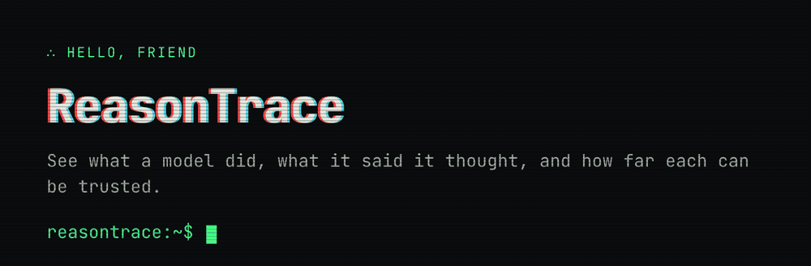
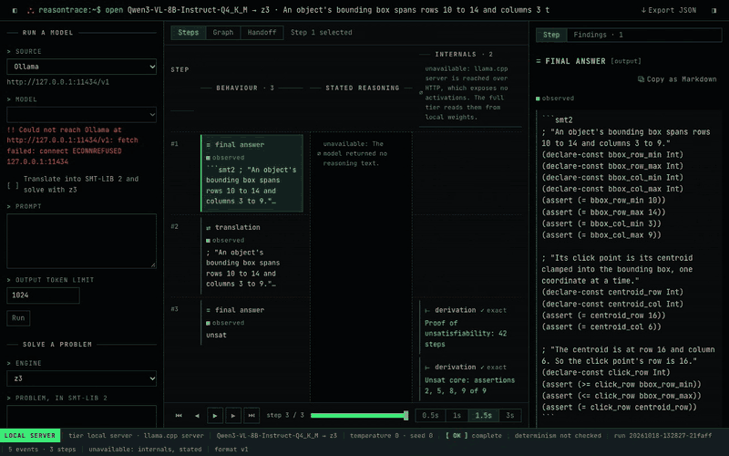
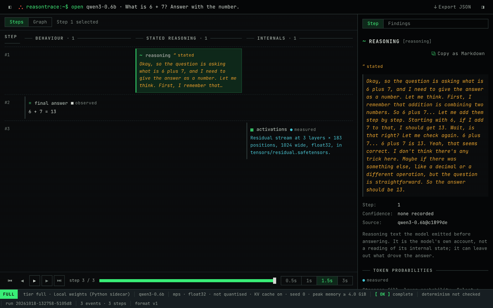
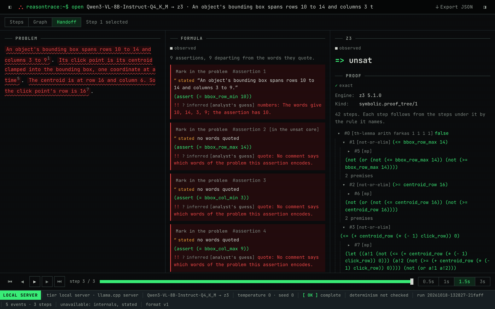
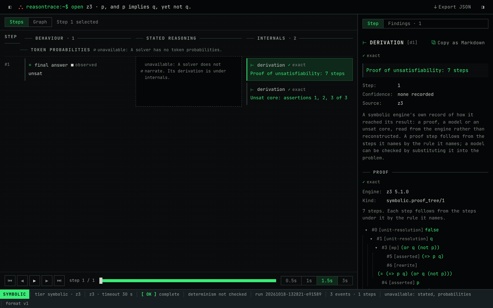
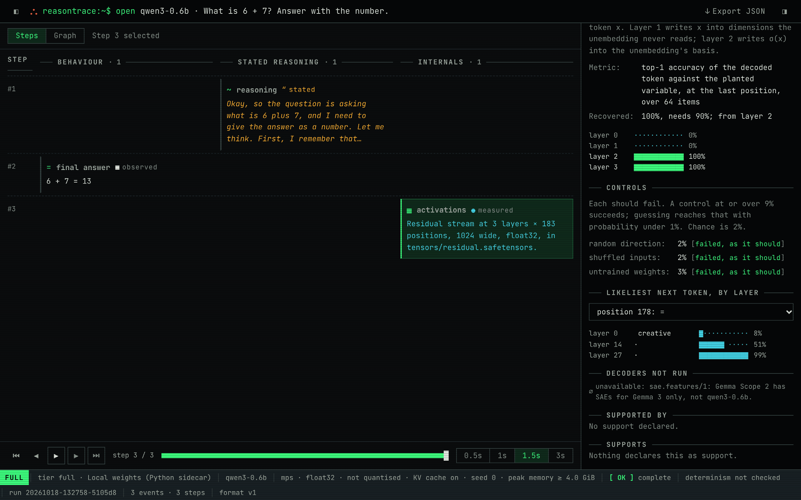
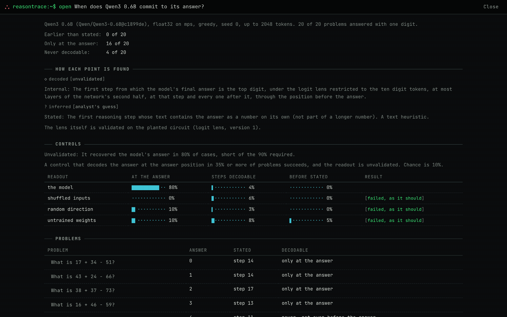

<div align="center">



**A model will tell you how it reasoned. ReasonTrace sets that story beside the receipts.**

Every value wears a label for how far it can be trusted, and whatever a model
can't show is marked unavailable, with the reason.

[](https://github.com/kanishkpaul/reasontrace/actions/workflows/ci.yml)


</div>

```text
reasontrace:~$ open qwen3-0.6b · What is 6 + 7? Answer with the number.

  behaviour   ■ observed      6 + 7 = 13
  stated      “ stated        Okay, so the question is asking what is 6 plus 7…
  probs       ● measured      the 5 likeliest tokens at each generated token
  internals   ● measured      residual stream, 3 layers × 183 positions, float32
              ◆ decoded       logit lens, validated: 3 of 3 controls failed
              ∅ unavailable   SAE features: Gemma Scope 2 has SAEs for Gemma 3 only

[ OK ] complete · tier full · mps · float32 · seed 0
```

*Read from the run in
[`fixtures/runs/20261018-132758-5105d8`](fixtures/runs/20261018-132758-5105d8),
Qwen3 0.6B run from its weights. The marks are the viewer's own, so no label
depends on colour.*

It works with LLMs, with the z3 solver, and with pipelines in which an LLM
writes a formula and z3 solves it. It is a local web app: a TypeScript server
holds your keys and talks to models and solvers, a React viewer runs in your
browser, and an optional Python sidecar runs small models from their weights
to read their internals.



*A pipeline run from [`fixtures/runs/20261018-132827-21faff`](fixtures/runs/20261018-132827-21faff).
z3's "unsat" is exact, but the unsat core rests on `click_row = centroid_row`,
which drops the clamping the problem describes. The translation checks flag
the assertions whose quotes don't match the problem's words.*

**What was built:** a local server that runs hosted APIs, local model servers
and local weights; the z3 engine; model-to-solver pipelines; a Python sidecar
that captures the residual stream of Qwen3 0.6B and Gemma 3 1B and decodes it
with a logit lens and Gemma Scope 2 SAE features; one finding about when a
model commits to its answer; and a viewer for all of it.

**How it was tested:** every source replays recorded responses offline. Each
decoder is checked against a model with a planted circuit before it is shown
on a real one, and every decoded readout reports its controls. Captured
activations are compared with a stored reference, and a determinism check
compares repeated runs. Live tests run each source, engine and tier through
the server and check that no key reaches a run directory or the log.
[How it was checked](#how-it-was-checked) has the details.

## What it shows, and why

A model's account of its reasoning is not its reasoning. Models leave out what
drove an answer, and frontier APIs return summaries written by another model.
Internals are closer to what happened, but reading them takes a method, and a
method can find patterns that the model never uses. ReasonTrace keeps these
apart and labels each piece:

| Label | Meaning |
|---|---|
| ■ `observed` | the system emitted or did this |
| “ `stated` | the model's own account of its reasoning, marked when a provider wrote it as a summary |
| ✓ `exact` | a derivation read from the solver |
| ● `measured` | raw internal values, such as activations or token probabilities |
| ◇ `decoded` | an interpretation of internals by a method, shown with its control result |
| ? `inferred` | an analyst's reconstruction |
| ∅ unavailable | a depth this source cannot provide, with the reason |

Each label has its own mark and word, so none depends on colour
([`Marks.test.tsx`](apps/web/src/components/Marks.test.tsx)).



*Qwen3 0.6B run from its weights, from
[`fixtures/runs/20261018-132758-5105d8`](fixtures/runs/20261018-132758-5105d8).
The status line records the device, dtype, cache setting, seed and peak
memory.*

## What it will not claim

- **It does not say what a model "really thought".** It lines up evidence and
  says how much each piece can bear.
- **A decoded signal is a hypothesis.** A decoder is shown as validated only
  when it recovers a planted variable and every control fails; otherwise it
  says "unvalidated" and why
  ([`DecodedView.test.tsx`](apps/web/src/components/DecodedView.test.tsx),
  [`test_ground_truth.py`](bridge/python/tests/test_ground_truth.py),
  [`test_verdict.py`](bridge/python/tests/test_verdict.py)).
- **It does not reveal a closed model's hidden reasoning.** A provider's
  summary is labelled as one
  ([`anthropic/src/index.test.ts`](packages/sources/anthropic/src/index.test.ts)),
  and a model that hides its reasoning shows that depth as unavailable
  ([`openai/src/source.test.ts`](packages/sources/openai/src/source.test.ts)).
- **An honest zero never looks like a silent zero.** Timeouts, refusals,
  truncation, stopped runs and errors are each recorded as what they are
  ([`openai/src/source.test.ts`](packages/sources/openai/src/source.test.ts),
  [`engine.test.ts`](packages/engines/z3/src/engine.test.ts)).
- **The translation checks read words, not meaning.** They compare each
  assertion with the words its comment quotes, and every pipeline run says so
  ([`translation.test.ts`](packages/analysis/src/translation.test.ts)).

The full list is in the [charter](docs/CHARTER.md).

## Run it

You need Node `^22.22.2` or `>=24.15.0`.

```bash
git clone https://github.com/kanishkpaul/reasontrace.git
cd reasontrace
npm install
npm run check
npm start
```

`npm run check` runs lint, typecheck, the tests, the dependency rules, the
colour, contrast and motion checks, and the build. `npm start` builds the
viewer and serves it at <http://127.0.0.1:4317>. Your runs go to `runs/`.

To open the runs the screenshots here were taken from:

```bash
npm start -- --runs fixtures/runs
```

To run models from their weights, install [uv](https://docs.astral.sh/uv/) and
the sidecar's model runtime. The weights download on first run; Gemma 3 needs
its licence accepted on Hugging Face first.

```bash
uv sync --directory bridge/python --extra model
```

Hosted providers take your own key, entered in the viewer and stored in the OS
keychain. It never reaches a run directory, the log or the browser
([`app.test.ts`](apps/server/src/app.test.ts), "keys never reach the run
directory or the log").

## What each source can show

What a model exposes depends on how it is reached. Each source declares what
it cannot provide before it runs, and the viewer shows that depth as
unavailable with the source's reason
([`StepColumns.test.tsx`](apps/web/src/components/StepColumns.test.tsx)).

| Tier | Sources | Behaviour | Stated reasoning | Token probabilities | Internals |
|---|---|---|---|---|---|
| Full | Qwen3 0.6B and Gemma 3 1B, run from their weights by the sidecar | yes | raw, from Qwen3 | yes | residual stream to a capture plan; logit lens; Gemma Scope 2 SAE features for Gemma 3 1B |
| Local server | Ollama, LM Studio, llama.cpp server, vLLM | yes | raw, from a reasoning field or `<think>` tags | where the server returns them | unavailable |
| Open API | OpenRouter, Groq, OpenAI chat models | yes | where the provider returns it | where the provider returns them | unavailable |
| Frontier API | Anthropic, Gemini, OpenAI reasoning models | yes | Anthropic's summaries; unavailable for the others | none from Anthropic; Gemini and OpenAI where returned | unavailable |
| Symbolic | z3 | the result | none: a solver does not narrate | none | exact: proof, model, unsat core |

A **pipeline** joins the two: a model at its own tier translates a problem
into SMT-LIB, and z3 solves it. The translation is an event of its own, and
each assertion is checked against the words it quotes for numbers and
comparisons ([`translation.test.ts`](packages/analysis/src/translation.test.ts),
[`HandoffView.test.tsx`](apps/web/src/components/HandoffView.test.tsx)).





*The handoff for the pipeline run above, and a z3 proof from
[`fixtures/runs/20261018-132821-e91589`](fixtures/runs/20261018-132821-e91589).
A large proof keeps the steps nearest the conclusion and records the cut
([`engine.test.ts`](packages/engines/z3/src/engine.test.ts)).*

### Internals and their controls

The sidecar captures the residual stream with nnsight at the layers and
positions a capture plan names, and stores it as safetensors in the run
directory. The capture matches a stored transformers reference within a
stated tolerance ([`test_reference.py`](bridge/python/tests/test_reference.py)),
and two runs of one plan pass the determinism check
([`determinism.test.ts`](packages/core/src/determinism.test.ts),
[`sidecar/src/live.test.ts`](packages/sidecar/src/live.test.ts)).

Two decoders read a finished run:

- **The logit lens** is validated on a model with a planted circuit, against
  three controls: a random direction, shuffled inputs and untrained weights
  ([`test_ground_truth.py`](bridge/python/tests/test_ground_truth.py)). The
  viewer shows that validation beside every readout.
- **Gemma Scope 2 SAE features**, for Gemma 3 1B. They reconstruct captured
  activations as well as the release reports
  ([`test_sae_gate.py`](bridge/python/tests/test_sae_gate.py)), but they have
  no planted-circuit control, so they are always shown as unvalidated.



### One finding

[`fixtures/findings/answer-commitment-qwen3-0.6b.json`](fixtures/findings/answer-commitment-qwen3-0.6b.json)
asks when Qwen3 0.6B commits to its answer on twenty one-digit arithmetic
problems: whether the answer becomes decodable from its internals before its
reasoning states it. In this run it never did, but the lens readout recovered
the model's own answer in 80% of cases, short of the 90% the finding requires.
The readout is unvalidated, so the result cannot bear the claim either way,
and the viewer says so
([`FindingView.test.tsx`](apps/web/src/components/FindingView.test.tsx),
[`test_findings.py`](bridge/python/tests/test_findings.py)).



### Trace files

The viewer also opens agent traces (`Thought:` / `Action:` transcripts,
chat-message JSON, OpenAI Responses output and its own event JSON) as a
replayable graph with rule-based findings. Each finding states its rule and
what it cannot tell
([`parseTrace.test.ts`](packages/analysis/src/parseTrace.test.ts),
[`diagnostics.test.ts`](packages/analysis/src/diagnostics.test.ts)).

## How it is built

```
format  ◄──  analysis
   ▲
   └──  core  ◄──  capability packages  ◄──  apps/server
                                                 │
 apps/web  ──► format, analysis, and /api only ◄─┘
```

- `packages/format` is the trace format: events, evidence labels, run
  manifests and attachments.
- `packages/core` writes and reads run directories and holds the `Source` and
  `Engine` interfaces.
- The capability packages are the sources (`packages/sources/*`), the
  engines (`packages/engines/*`) and the sidecar bridge (`packages/sidecar`).
  They never depend on each other, so each one can be removed by deleting a
  package and one registration line.
- `apps/server` (Hono on Node) wires them in, keeps keys in the OS keychain,
  answers only requests addressed to this machine that carry its launch
  token, and streams runs to the viewer
  ([`app.test.ts`](apps/server/src/app.test.ts)).
- `apps/web` (React) reaches everything through the HTTP API and loads
  nothing from another host ([`offline.test.ts`](apps/web/src/offline.test.ts)).
- `bridge/python` is the sidecar: nnsight for capture and SAELens for Gemma
  Scope 2, over JSON-RPC on stdin and stdout.

`npm run check:deps` enforces the dependency rules
([`check-deps.test.ts`](scripts/check-deps.test.ts)). Each run writes
`runs/<id>/` with its manifest, events, attachments and any tensors. A run
from weights also records the model revision, dtype, device, cache, seed and
library versions.

**To add a source:** create a package under `packages/sources/` that
implements `Source`, add it to `apps/server/package.json`, add one line to
`apps/server/src/registry.ts`, and add recorded fixtures and tests inside the
package. The checklist is in
[ARCHITECTURE.md §5](docs/ARCHITECTURE.md#5-adding-or-removing-a-capability).

## How it was checked

- **Offline tests.** `npm run check` never touches the network; each source
  replays recorded responses through a fixture `fetch`
  ([`test/noNetwork.ts`](test/noNetwork.ts)). Each fixture says where it came
  from: a llama.cpp server, llama.cpp standing in for a provider's API, or a
  provider's documentation for replies only a provider sends
  ([OpenAI-compatible fixtures](packages/sources/openai/fixtures/README.md),
  [Anthropic fixtures](packages/sources/anthropic/fixtures/README.md)).
- **Gates on ground truth.** The planted circuit, the activation reference,
  the SAE reconstruction and the determinism check each have a test, and a
  test that shows the check can fail
  ([`bridge/python/tests`](bridge/python/tests),
  [`determinism.test.ts`](packages/core/src/determinism.test.ts)).
- **Live tests.** `npm run test:live` runs every source, engine and tier the
  machine has through the server, leaves a run directory for each, and checks
  that no key bytes reach a run directory or the server log. Each source is
  reported as passed, failed with the error, or skipped with the reason
  ([`live.test.ts`](apps/server/src/live.test.ts)). To test the hosted sources
  without provider keys, run them against a llama.cpp server started with a
  dummy key:

  ```bash
  llama-server -hf Qwen/Qwen3-0.6B-GGUF:Q8_0 --jinja --port 8081 --api-key dummy-key
  RT_LIVE_STAND_IN=http://127.0.0.1:8081/v1 RT_LIVE_STAND_IN_KEY=dummy-key npm run test:live
  ```

  That checks our side of each API, not the provider's
  ([PLAN.md D-6](docs/PLAN.md#2-decisions)).
- **The viewer's look.** Colours come only from tokens, every text colour
  reaches WCAG AA on every background, and animation runs only when reduced
  motion is off ([`check-style.test.ts`](scripts/check-style.test.ts),
  [`check-colours.test.ts`](scripts/check-colours.test.ts)).
- **CI** runs the checks on Node 22 and 24, the sidecar tests without the
  model runtime, and a check that no commit credits an AI tool
  ([`ci.yml`](.github/workflows/ci.yml)).

Open bugs are listed by ID in [PLAN.md](docs/PLAN.md#4-found-by-live-testing).

## Documents

- [Charter](docs/CHARTER.md): what the tool is and what it will not claim.
- [Architecture](docs/ARCHITECTURE.md): packages, the trace format, extension
  points, and how to add or remove a capability.
- [Build plan](docs/BUILD_PLAN.md): phases and their gates.
- [Plan](docs/PLAN.md): the bug audit, the decisions and the open bugs.
- [Style](docs/STYLE.md) and [the viewer's style](apps/web/STYLE.md): how
  code, comments and the interface are written.
- [Failure modes](FAILURE_MODES.md): how work here goes wrong, and the checks.
- [Borrowed](docs/BORROWED.md): external code, weights and ideas, with their
  licences.
- [AGENTS.md](AGENTS.md): rules for anyone, human or agent, writing code here.

## License

MIT
