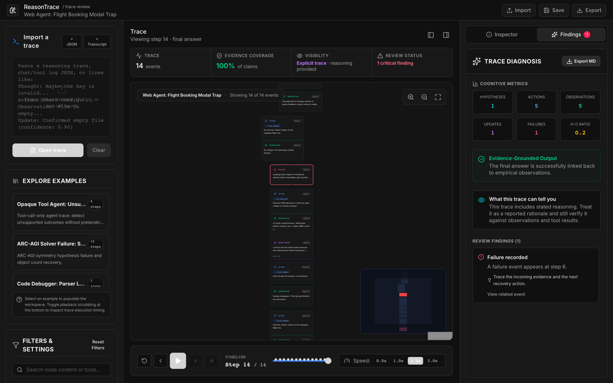

# ReasonTrace

An interpretability tool for seeing how models reason. It captures what a model
does, what it says it was thinking, and what happens inside it, and shows them
side by side, step by step, with each piece labelled by how far it can be
trusted. It works with neural, symbolic and neurosymbolic models, using your
own API keys or models running on your machine.

It is a local web app: a TypeScript server on your machine holds your keys and
talks to models and solvers, a React viewer runs in your browser, and an
optional Python sidecar reads model internals.



## Where it is

The viewer opens agent trace files (plain `Thought:` / `Action:` transcripts,
chat-message JSON, OpenAI Responses output, and native event JSON) and draws
them as a replayable graph with rule-based findings. Nothing runs a model yet.
The findings are not reliable: [docs/PLAN.md](docs/PLAN.md) lists the known
defects, and each has a test that fails until it is fixed.

```bash
npm install
npm run dev        # http://localhost:5173
npm run check      # lint, typecheck, tests, dependency rules, build
```

Needs Node 22.22.2+ or 24.15+ (the test tools, jsdom and ESLint, set the floor).

## What it will show

| How the model is reached | What you can see |
|---|---|
| Weights run in the Python sidecar (Gemma 3, Qwen3 first) | behaviour, raw reasoning, token probabilities, activations, lenses, SAE features, probes, interventions |
| A local server (Ollama, LM Studio, llama.cpp, vLLM) | behaviour, raw reasoning from open models, token probabilities where supported |
| Your own API key (OpenAI, Anthropic, Gemini, OpenRouter, …) | behaviour, provider reasoning summaries, token probabilities where supported |
| A symbolic engine (z3, Datalog) | queries, results, and the exact derivation |

What a source cannot provide is shown as unavailable, with the reason. Signals
decoded from a model's internals carry the result of their control.

## Documents

- [Charter](docs/CHARTER.md): what the tool is and what it will not claim.
- [Architecture](docs/ARCHITECTURE.md): packages, the trace format, extension
  points, and how to add or remove a capability.
- [Build plan](docs/BUILD_PLAN.md): phases and their gates.
- [Plan](docs/PLAN.md): the bug audit and the stack decisions.
- [Style](docs/STYLE.md): how code and comments are written.
- [Failure modes](FAILURE_MODES.md): how work here goes wrong, and the checks.
- [Borrowed](docs/BORROWED.md): external code, weights and ideas.
- [AGENTS.md](AGENTS.md): rules for anyone, human or agent, writing code here.

## License

MIT
